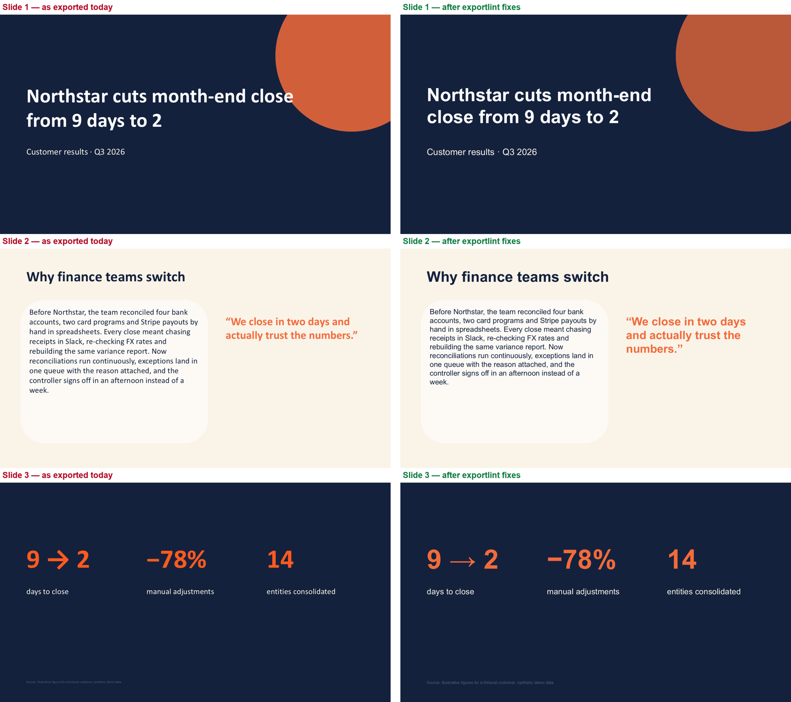

# Moda PPTX export-fidelity linter (prototype)

**The problem.** Moda's pitch is a fully editable canvas that exports to PowerPoint, Google Slides and Keynote. Users on the [Moda Product Hunt page](https://www.producthunt.com/products/moda-2) asked for better PowerPoint/Google Slides export fidelity for customer-facing decks. When a deck leaves the canvas, a few things break in predictable ways:

- the brand font isn't installed on the viewer's machine, so PowerPoint swaps in the theme font (Calibri), the text reflows, and headlines spill out of their boxes
- canvas effects like blend modes and backdrop blur have no PPTX equivalent
- colours drift off the brand palette, and small text drops below a readable size

**What I built.** A linter that runs *before* export. It reads a layered canvas scene and predicts each of these problems, applies safe fixes, writes the .pptx, re-reads it to check nothing moved, and then checks itself against real PowerPoint.

| Check | How |
|---|---|
| `FONT_SUBSTITUTED` | Font not installed or embeddable → names the font PowerPoint will actually use (read from the deck's theme) |
| `TEXT_OVERFLOW` | Greedy word-wrap using Pillow glyph metrics of the font that will really render, with PowerPoint's default insets and line height |
| `UNSUPPORTED_EFFECT` | Blend modes and backdrop blur |
| `OFF_BRAND_COLOR` | CIE ΔE76 > 10 from every palette colour |
| `TEXT_TOO_SMALL` / `OFF_BRAND_FONT` | Brand-kit rules |
| `GEOMETRY_DRIFT` / `TEXT_PROPS_CHANGED` / `LAYER_LOST` | Round trip: re-read the exported .pptx and compare it layer by layer |

Fixes: map each font to the brand's fallback font, shrink text to fit (never below the brand minimum, and anything that still won't fit is sent to a human), replace unsupported effects with a solid fill plus transparency, and snap colours to the nearest brand colour.

## Result (synthetic 3-slide deck, `samples/northstar_deck.json`)

- **10 issues found** before export (2 font families affecting 12 layers, 2 overflows, 2 unsupported effects, 3 off-brand colours, 1 too-small footer). **0 left after fixes.** Round trip: **0** layers lost, moved or changed.
- **Checked against real PowerPoint.** I opened both decks in PowerPoint (Windows, via COM) and asked it for each text box's actual line count and text height (`exportlint/measure.ps1`). The linter's overflow prediction matched PowerPoint on **24/24 text boxes**, and its line count matched on **24/24**. Before the fixes, PowerPoint showed overflow in `s1/title` and `s2/body`. After the fixes, it showed none.
- Honest limits: this is one small deck with Latin text, PowerPoint on Windows, and the default theme. It doesn't cover kerning edge cases, CJK, line-spacing overrides, Keynote or Google Slides yet.



*Left: the deck as exported. Right: after the fixes. Both rendered by PowerPoint itself.*

## Run

```bash
pip install -r requirements.txt
python demo.py              # lint → fix → export before/after .pptx → round-trip check
python -m pytest -q         # 10 tests, including the PowerPoint ground-truth comparison
```

On Windows with PowerPoint installed, `python demo.py --render` also renders both decks to PNG and re-measures every text box inside PowerPoint.

## Layout

```
exportlint/core.py      lint, fix, export (python-pptx), round trip
exportlint/render.ps1   PowerPoint COM → PNG per slide
exportlint/measure.ps1  PowerPoint COM → real line count / text height per text box
demo.py                 end-to-end run + agreement report + side-by-side image
samples/                synthetic brand + deck with planted issues
tests/                  10 pytest tests (fixtures = PowerPoint measurements)
```

All data is synthetic. "Northstar" is a fictional customer.

Unofficial prototype by Kushagra Pratap Singh. Not affiliated with Moda.
